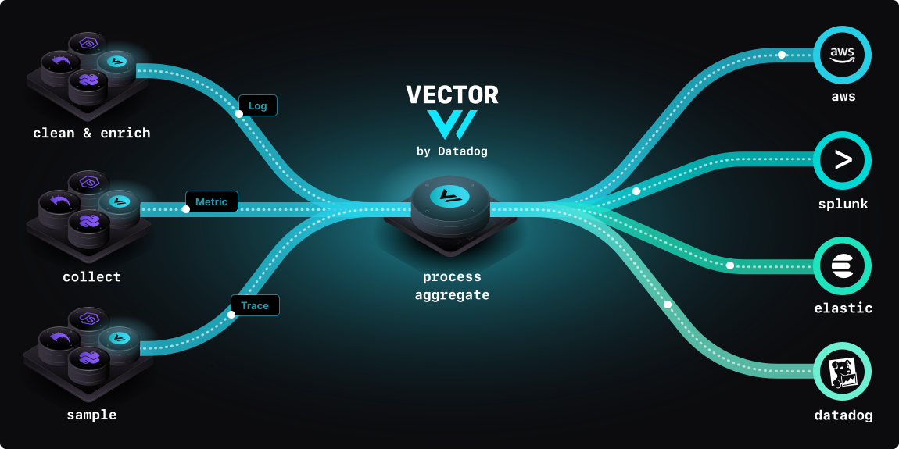

  

  <strong>
    <a href="https://vector.dev/docs/setup/quickstart/">Quickstart</a>&nbsp;&nbsp;&bull;&nbsp;&nbsp;
    <a href="https://vector.dev/docs/">Docs</a>&nbsp;&nbsp;&bull;&nbsp;&nbsp;
    <a href="https://vector.dev/guides/">Guides</a>&nbsp;&nbsp;&bull;&nbsp;&nbsp;
    <a href="https://vector.dev/components/">Integrations</a>&nbsp;&nbsp;&bull;&nbsp;&nbsp;
    <a href="https://chat.vector.dev">Chat</a>&nbsp;&nbsp;&bull;&nbsp;&nbsp;
    <a href="https://vector.dev/releases/latest/download/">Download</a>&nbsp;&nbsp;&bull;&nbsp;&nbsp;
    <a href="https://github.com/vectordotdev/vector/pkgs/container/vector">Container Images</a>
  </strong>

## What is Vector?

Vector is a high-performance, end-to-end (agent & aggregator) observability data
pipeline that puts you in control of your observability data.
[Collect][docs.sources], [transform][docs.transforms], and [route][docs.sinks]
all your logs and metrics to any vendors you want today and any other
vendors you may want tomorrow. Vector enables dramatic cost reduction, novel
data enrichment, and data security where you need it, not where it is most
convenient for your vendors. Vector is 100% open source. The complete source code
and all features are publicly available.

To get started, follow our [**quickstart guide**][docs.quickstart] or [**install
Vector**][docs.installation].

Vector is maintained by Datadog's [Community Open Source Engineering team](https://opensource.datadoghq.com/about/#the-community-open-source-engineering-team).

### Principles

* **Reliable** - Built in [Rust][urls.rust], Vector's primary design goal is reliability.
* **End-to-end** - Deploys as an [agent][docs.roles#agent] or [aggregator][docs.roles#aggregator]. Vector is a complete platform.
* **Unified** - Stable support for [logs][docs.data-model.log] and
  [metrics][docs.data-model.metric] in one pipeline. Trace support is available
  in selected components, including the [OpenTelemetry source][docs.sources.opentelemetry].
  When building a trace pipeline, check each component's supported event types and limitations.

### Use cases

* Reduce total observability costs.
* Transition vendors without disrupting workflows.
* Enhance data quality and improve insights.
* Consolidate agents and eliminate agent fatigue.
* Improve overall observability performance and reliability.

### Community

* Vector powers observability pipelines at [Atlassian][users.atlassian],
  [Riot Games][users.riot_games], [Comcast][users.comcast],
  [FanDuel][users.fanduel], [Zerodha][users.zerodha],
  [Timescale][users.timescale], [Quad9][users.quad9],
  [OpenAI][users.openai], [Anthropic][users.anthropic],
  and [many more][urls.production_users].
* [Contributors][urls.contributors]

## Documentation

All user documentation is available at **[vector.dev/docs](https://vector.dev/docs)**.

To build and verify a pipeline:

1. [Develop a configuration][docs.quickstart] and transform events with [VRL][docs.reference.vrl].
2. [Validate the configuration][docs.administration.validating] with `vector validate`.
3. [Test transform behavior][docs.configuration.tests] with `vector test`.
4. [Inspect a running pipeline][docs.guides.debugging] with `vector top` and `vector tap`.

Other Resources:

* [**Vector Calendar**][urls.vector_calendar]
* **Policies**:
  * [**Code of Conduct**][urls.vector_code_of_conduct]
  * [**Contributing**][urls.vector_contributing_policy]
  * [**Privacy**][urls.vector_privacy_policy]
  * [**Releases**][urls.vector_releases_policy]
  * [**Versioning**][urls.vector_versioning_policy]
  * [**Security**][urls.vector_security_policy]

## Testing and benchmarks

The [Vector test harness][urls.vector_test_harness] contains functional checks
and performance workloads, with documented configurations, environments, and
results. When evaluating Vector, benchmark a representative pipeline and verify
the records delivered to its destination. Performance depends on the workload,
configuration, hardware, and software versions.

---

  Developed with ❤️ by <strong><a href="https://datadoghq.com">Datadog</a></strong> - <a href="https://github.com/vectordotdev/vector/security/policy">Security Policy</a> - <a href="https://github.com/vectordotdev/vector/blob/master/PRIVACY.md">Privacy Policy</a>

[docs.about.concepts]: https://vector.dev/docs/introduction/concepts/
[docs.about.introduction]: https://vector.dev/docs/introduction/
[docs.administration.monitoring]: https://vector.dev/docs/administration/monitoring/
[docs.administration.management]: https://vector.dev/docs/administration/management/
[docs.administration.upgrading]: https://vector.dev/docs/administration/upgrading/
[docs.administration.validating]: https://vector.dev/docs/administration/validating/
[docs.architecture.concurrency-model]: https://vector.dev/docs/architecture/concurrency-model/
[docs.architecture.data-model]: https://vector.dev/docs/architecture/data-model/
[docs.architecture.pipeline-model]: https://vector.dev/docs/architecture/pipeline-model/
[docs.architecture.runtime-model]: https://vector.dev/docs/architecture/runtime-model/
[docs.configuration.sinks]: https://vector.dev/docs/reference/configuration/sinks/
[docs.configuration.sources]: https://vector.dev/docs/reference/configuration/sources/
[docs.configuration.tests]: https://vector.dev/docs/reference/configuration/unit-tests/
[docs.configuration.transforms]: https://vector.dev/docs/reference/configuration/transforms/
[docs.configuration.enrichment_tables]: https://vector.dev/docs/reference/configuration/global-options/#enrichment_tables
[docs.data-model.log]: https://vector.dev/docs/architecture/data-model/log/
[docs.data-model.metric]: https://vector.dev/docs/architecture/data-model/metric/
[docs.deployment.roles]: https://vector.dev/docs/setup/deployment/roles/
[docs.deployment.topologies]: https://vector.dev/docs/setup/deployment/topologies/
[docs.deployment]: https://vector.dev/docs/setup/deployment/
[docs.installation.manual]: https://vector.dev/docs/setup/installation/manual/
[docs.installation.operating_systems]: https://vector.dev/docs/setup/installation/operating-systems/
[docs.installation.package_managers]: https://vector.dev/docs/setup/installation/package-managers/
[docs.installation.platforms]: https://vector.dev/docs/setup/installation/platforms/
[docs.installation]: https://vector.dev/docs/setup/installation/
[docs.architecture.adaptive-request-concurrency]: https://vector.dev/docs/architecture/arc/
[docs.platforms.kubernetes]: https://vector.dev/docs/setup/installation/platforms/kubernetes/
[docs.guides.debugging]: https://vector.dev/guides/developer/debugging/
[docs.quickstart]: https://vector.dev/docs/setup/quickstart/
[docs.reference.api]: https://vector.dev/docs/reference/api/
[docs.reference.cli]: https://vector.dev/docs/reference/cli/
[docs.reference.vrl]: https://vector.dev/docs/reference/vrl/
[docs.roles#agent]: https://vector.dev/docs/setup/deployment/roles/#agent
[docs.roles#aggregator]: https://vector.dev/docs/setup/deployment/roles/#aggregator
[docs.setup.installation]: https://vector.dev/docs/setup/installation/
[docs.setup.quickstart]: https://vector.dev/docs/setup/quickstart/
[docs.sinks.aws_cloudwatch_logs]: https://vector.dev/docs/reference/configuration/sinks/aws_cloudwatch_logs/
[docs.sinks.aws_s3]: https://vector.dev/docs/reference/configuration/sinks/aws_s3/
[docs.sinks.clickhouse]: https://vector.dev/docs/reference/configuration/sinks/clickhouse/
[docs.sinks.elasticsearch]: https://vector.dev/docs/reference/configuration/sinks/elasticsearch/
[docs.sinks.gcp_cloud_storage]: https://vector.dev/docs/reference/configuration/sinks/gcp_cloud_storage/
[docs.sinks]: https://vector.dev/docs/reference/configuration/sinks/
[docs.sources.docker_logs]: https://vector.dev/docs/reference/configuration/sources/docker_logs/
[docs.sources.file]: https://vector.dev/docs/reference/configuration/sources/file/
[docs.sources.http]: https://vector.dev/docs/reference/configuration/sources/http/
[docs.sources.journald]: https://vector.dev/docs/reference/configuration/sources/journald/
[docs.sources.opentelemetry]: https://vector.dev/docs/reference/configuration/sources/opentelemetry/
[docs.sources.kafka]: https://vector.dev/docs/reference/configuration/sources/kafka/
[docs.sources.socket]: https://vector.dev/docs/reference/configuration/sources/socket/
[docs.sources]: https://vector.dev/docs/reference/configuration/sources/
[docs.transforms.dedupe]: https://vector.dev/docs/reference/configuration/transforms/dedupe/
[docs.transforms.filter]: https://vector.dev/docs/reference/configuration/transforms/filter/
[docs.transforms.log_to_metric]: https://vector.dev/docs/reference/configuration/transforms/log_to_metric/
[docs.transforms.lua]: https://vector.dev/docs/reference/configuration/transforms/lua/
[docs.transforms.remap]: https://vector.dev/docs/reference/configuration/transforms/remap/
[docs.transforms]: https://vector.dev/docs/reference/configuration/transforms/
[docs.introduction.architecture]: https://vector.dev/docs/architecture/
[docs.introduction.guarantees]: https://vector.dev/docs/introduction/guarantees/
[docs.introduction.architecture]: https://vector.dev/docs/architecture/
[urls.contributors]: https://github.com/vectordotdev/vector/graphs/contributors
[users.atlassian]: https://github.com/vectordotdev/vector/issues/790#issuecomment-771352503
[users.riot_games]: https://github.com/vectordotdev/vector/issues/790#issuecomment-2344338242
[users.comcast]: https://github.com/vectordotdev/vector/issues/790#issuecomment-676373980
[users.fanduel]: https://github.com/vectordotdev/vector/issues/790#issuecomment-2471802445
[users.zerodha]: https://github.com/vectordotdev/vector/issues/790#issuecomment-1681726280
[users.timescale]: https://github.com/vectordotdev/vector/issues/790#issuecomment-2304712820
[users.quad9]: https://github.com/vectordotdev/vector/issues/790#issuecomment-2950776289
[users.openai]: https://openai.com/index/harness-engineering/
[users.anthropic]: https://clickhouse.com/blog/how-anthropic-is-using-clickhouse-to-scale-observability-for-ai-era
[urls.production_users]: https://github.com/vectordotdev/vector/issues/790
[urls.rust]: https://www.rust-lang.org/
[urls.vector_calendar]: https://calendar.vector.dev
[urls.vector_chat]: https://chat.vector.dev
[urls.vector_code_of_conduct]: https://github.com/vectordotdev/vector/blob/master/CODE_OF_CONDUCT.md
[urls.vector_contributing_policy]: https://github.com/vectordotdev/vector/blob/master/CONTRIBUTING.md
[urls.vector_community]: https://vector.dev/community/
[urls.vector_privacy_policy]: https://github.com/vectordotdev/vector/blob/master/PRIVACY.md
[urls.vector_release_policy]: https://github.com/vectordotdev/vector/blob/master/RELEASING.md
[urls.vector_releases]: https://vector.dev/releases/
[urls.vector_releases_policy]: https://github.com/vectordotdev/vector/blob/master/RELEASES.md
[urls.vector_security_policy]: https://github.com/vectordotdev/vector/security/policy
[urls.vector_test_harness]: https://github.com/vectordotdev/vector-test-harness/
[urls.vector_twitter]: https://twitter.com/vectordotdev
[urls.vector_versioning_policy]: https://github.com/vectordotdev/vector/blob/master/VERSIONING.md
[urls.vote_feature]: https://github.com/vectordotdev/vector/issues?q=is%3Aissue+is%3Aopen+sort%3Areactions-%2B1-desc+type%3AFeature
