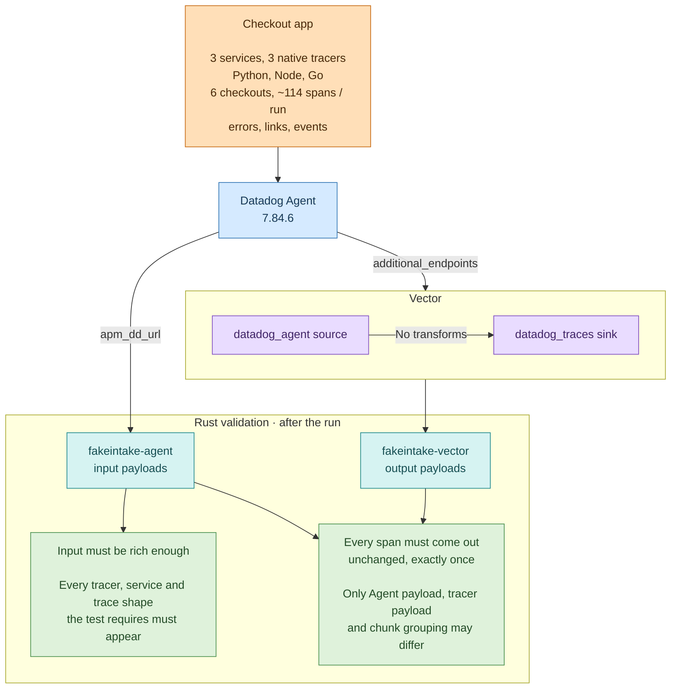

# Datadog Agent trace validation

This E2E test checks that Vector relays native Datadog tracer traffic from a real
Datadog Agent without losing or changing spans. It provides evidence for the
[trace model RFC](../../../rfcs/2026-04-29-25329-trace-data-model.md) migration PRs on the
Datadog side, as the
[multiservice OpenTelemetry test](../opentelemetry-traces-multiservice/README.md) does for
OTLP.

## Input and destination



- [Workload](workload): three small services instrumented with pinned native tracers
  (ddtrace 4.16.0, dd-trace-js 6.21.0, dd-trace-go 2.11.2). The client sends six
  checkouts and exits.
- [Agent config](data/agent.yaml): the Agent sends the same payload body to both
  endpoints, so `fakeintake-agent` records exactly what Vector received.
- [Vector config](data/vector.yaml): a `datadog_agent` source feeds a `datadog_traces`
  sink with no transforms.
- Destination: [fakeintake](https://github.com/DataDog/datadog-agent/tree/main/test/fakeintake),
  so no Datadog account or credentials are needed.

## Completion

Compose starts the tracers only after the Agent answers `/info`, and the client only
after the frontend and both downstream services accept connections. When the client
exits, [finalize.py](data/finalize.py) stops the services in order. Each tracer flushes
on stop, then the Agent flushes to both endpoints, then Vector drains its sink. Any
unclean exit fails the run, and so does Vector logging a graceful-shutdown timeout,
because it exits 0 in that case. Rust then reads the still-running fakeintakes, so `vdev
e2e test` can be rerun against the same captures.

## Validations

The [Rust test](../datadog/traces/mod.rs) verifies:

- Input guard: no indexed tracer payloads, which the source would drop.
- Completeness: all six checkout traces contain spans from all three tracers, so a
  tracer that failed to flush fails the run.
- Coverage: the input contains all three tracers and five services, sampling
  priorities 1 and 2, roots, cross-service parents, a trace spread across tracer
  payloads, multi-service chunks, several chunks in one tracer payload, error spans with
  `error.message`, `_dd.p.tid` (128-bit trace IDs), native span links and span events.
- Preservation: every span reaches the output exactly once and byte-for-byte unchanged.
  Missing, extra, duplicate and changed spans fail. Only the grouping into Agent, tracer
  payloads and chunks may differ.

Results are written to the `datadog_traces_evidence` volume: `summary.md`,
`coverage.json`, `differences.txt` and the decoded `input.txt` and `output.txt`. CI does
not upload that volume, so a failure also prints the first three differences in the test
log.

## Why this workload

Datadog-specific fields, such as `_dd.p.tid`, sampling tags and tracer metadata, only
come from native tracers, so the input is real tracer traffic rather than OTLP converted
by the Agent. The workload stays small and deterministic because:

- Structural RFC behaviors are covered by this app: distributed traces, chunks with
  several services, errors, links and events, 128-bit IDs and priorities.
- Edge cases are better as fixtures: `meta_struct`, NaN values, keys in both `meta` and
  `metrics`, invalid IDs. An app can't produce these reliably.

## Running

```shell
cargo vdev e2e run datadog-traces
```

In CI, a Vector-team member can submit a PR review starting with
`/ci-run-e2e-datadog-traces` to run it against the reviewed commit, or
`/ci-run-e2e-trace-model` to also run the
[multiservice OpenTelemetry test](../opentelemetry-traces-multiservice/README.md).
The merge queue runs it automatically when the paths in
[test.yaml](config/test.yaml) change.

## Known gaps

- Span-level only: Agent envelope, tracer payload and chunk fields are not compared yet.
  The current relay rewrites some of them, such as tracer payload `env` and merged tags.
- Indexed payloads: Agent 7.84+ sends them by default and Vector drops them, so the
  Agent sets `disable-convert-traces`. dd-trace-go v2 sends `/v1.0/traces`, which the
  Agent always forwards as indexed payloads, so the Go service is pinned to protocol
  0.4.
- Native span events come only from Python: Agent 7.84.6 rejects native span events from
  dd-trace-js 6.21.0.
- APM stats are not compared.
- Only top-level Python and Node dependencies are pinned, so transitive versions can
  change between image builds.
